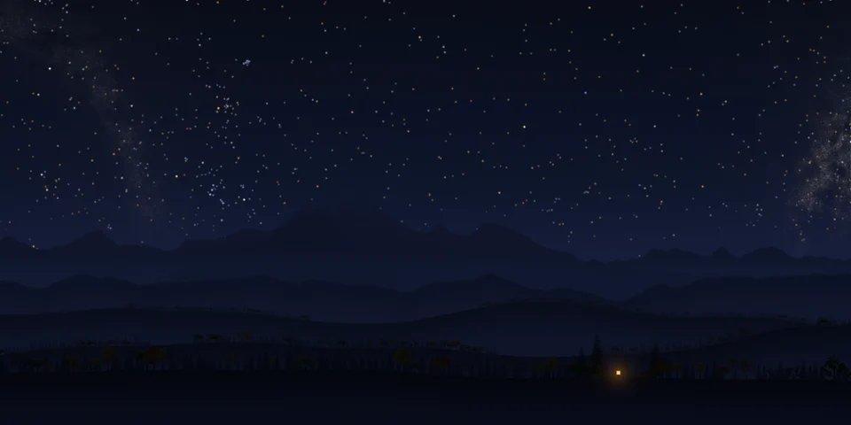
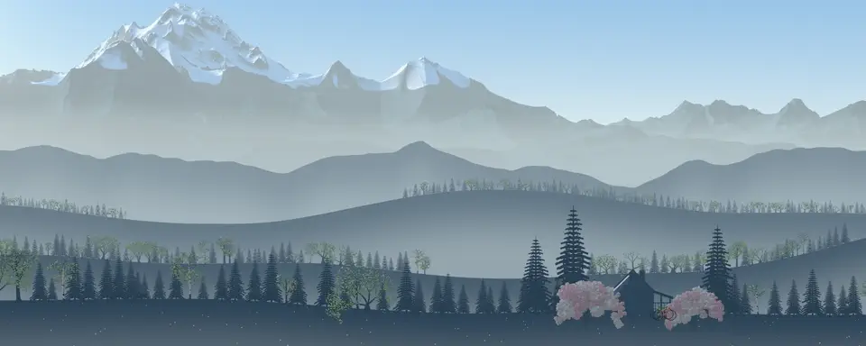
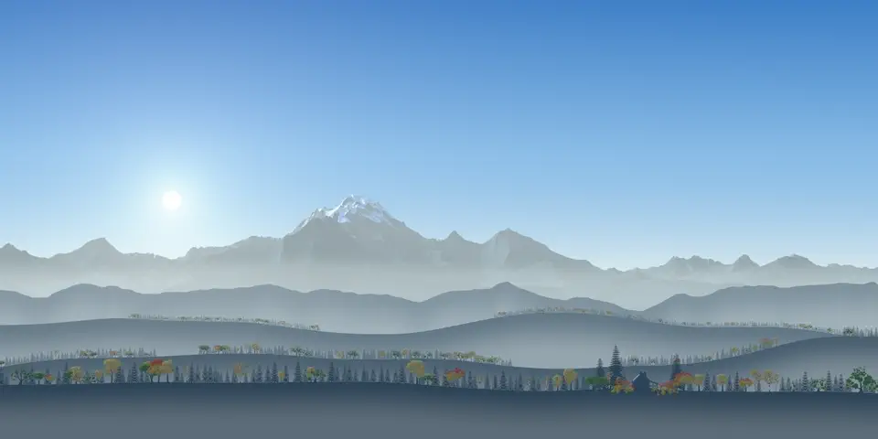
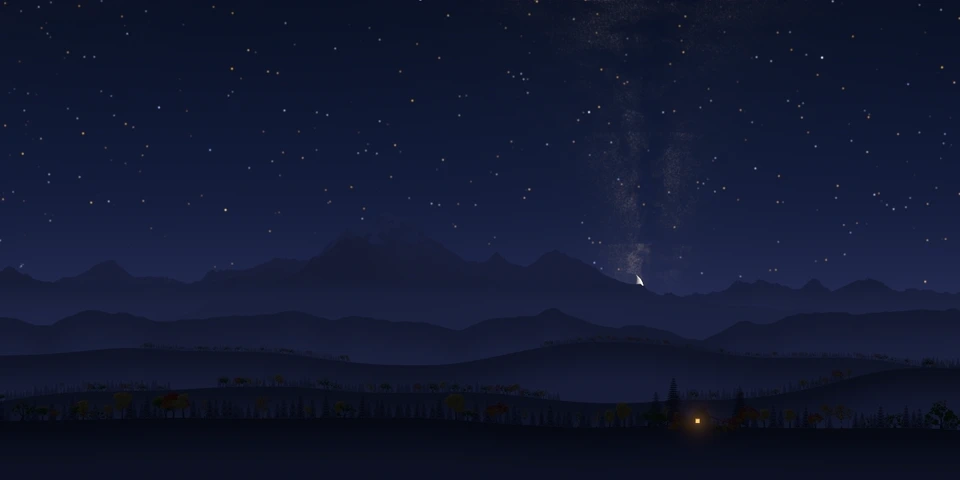
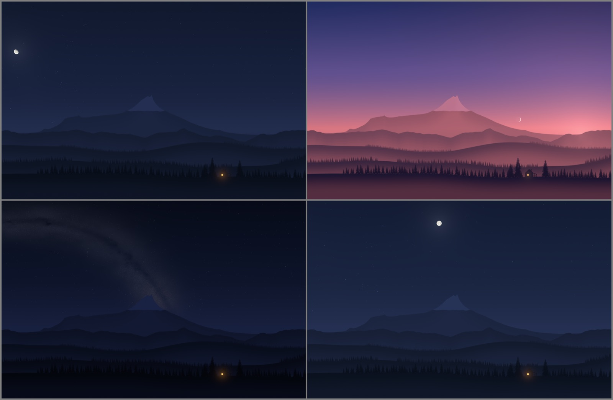
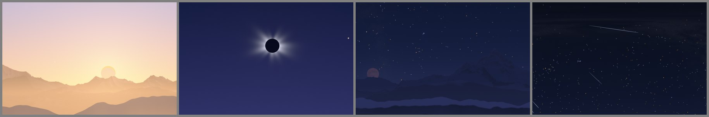
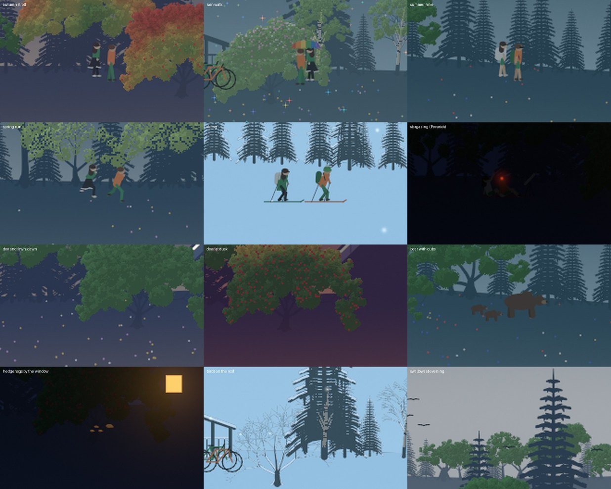

<div align="center">

# Sky wallpaper

**A living landscape for your desktop.**<br>
A snowcapped massif, a cabin in the woods and the real sky above it,<br>
drawn fresh every day for where you are.




**[Install on macOS](#macos)** · **[Install on Windows](#windows)** · **[How it works](#how-it-works)**

</div>

<br>

|  |  |
|---|---|
| 🌄 **The day** | 17 to 19 frames from midnight to night, on your real sunrise and sunset |
| 🌌 **The night** | The real moon, planets, 2,847 stars and the Milky Way, plus meteor showers and eclipses on their nights |
| 🍂 **The year** | Blossom, green leaves, autumn colours, fallen leaves, snow |
| ⛅ **The weather** | Follows the hourly forecast, always seen from above the clouds |
| 🏡 **Life** | Two people live in the cabin; deer, foxes, hares and, rarely, a bear come by |
| 🪶 **Light** | Still images, not video: nothing animates, nothing runs between frames |

## The year



Maple, birch, beech, oak and linden bud in spring and turn one by one in autumn,
from the top down. The apple trees by the cabin blossom in April. The summit's
snow rises and falls with the year. South of the equator, it's all half a year on.

## The weather



Grey days don't stay grey on your screen. When it's **overcast** you're above
it: a sunlit sea of clouds. **Fog** lies in the far valleys. **Rain** shows the
moment after, with a rainbow when the sun is low. **Snow** shows the clear
morning after.

## The night



Everything stands where it really is for your place and hour: the moon in its
phase, Mercury to Saturn, every star brighter than magnitude 5.5, the Milky Way
on dark nights. Meteor showers streak from their real radiants on their peak
nights. An eclipse seen from your place gets its own frame at its peak.

<details>
<summary><b>More nights:</b> eclipses, meteor showers, the Milky Way</summary>
<br>




The view faces the equator and spans 240°. The moon is drawn about eight
times its real size, as it looks to us, and bigger still near the horizon.

</details>

## Who lives there

Two people. Now and then they go out: a stroll, a run, a hike or ski tour,
a bike ride, a walk under a rainbow umbrella, stargazing on meteor nights,
or a hike so far off they're two specks on the range behind. Some things
keep to their season: a kite in spring and autumn wind, planting their
vegetable bed and picking flowers in spring, a picnic with a bottle of red
and, now and then, a tandem skydive in summer, a snowman when there's snow.
On the last Saturday in October they carve pumpkins, and the lanterns glow
by the steps until November.
Visitors come at their own hours: deer at dawn and dusk, a fox, hares,
hedgehogs on summer nights, swallows, geese, and, rarely, a bear with two cubs.

<details>
<summary><b>Close up</b></summary>
<br>



Each day's plan follows from its date, so a day's frames tell one story. They're
out in about 3% of frames, and the bear shows up about 25 times a year.

</details>

---

## macOS

Needs macOS 14+ and Swift (`xcode-select --install`).

```bash
git clone https://github.com/corpaci/sky-wallpaper.git && cd sky-wallpaper
mac/install.sh --lat 48.2 --lon 16.4
```

That's it. It renders each day at 00:05, at login and on wake, and follows your
sun and weather. To remove it and get your old wallpaper back, run `mac/uninstall.sh`.

<details>
<summary><b>Options and details</b></summary>
<br>

| Flag | What it does |
|---|---|
| `--lat`, `--lon` | Your location. Without it: your time zone's city |
| `--no-weather` | Stay offline; sunrise and sunset still follow the date |
| `--scale 1.5` | Bigger cabin, trees, people, sun and moon for high-res small screens (1, 1.25, 1.5, 1.75 or 2) |
| `--not-on-battery` | Skip rendering on battery |
| `--in-low-power` | Render even in Low Power Mode |
| `--extra WORD` | Secret words that change how the sky behaves. Which ones? Not written down anywhere. |

Run in a terminal, the installer asks about scaling, battery and extras.

- A day it skips (on battery, Low Power Mode) keeps the last sky up and
  catches up when you plug in.
- macOS only lets a program set the desktop that's showing, so a tiny helper
  (about 30 MB, no CPU when idle) puts today's sky on each Space as you switch to it.
- Logs: `~/Library/Application Support/SkyWallpaper/daily.log` and `follow.log`.
- Screen saver: to keep the sky when idle, set Lock Screen → Start Screen
  Saver when inactive → Never.

**Static file, nothing installed:**

```bash
SUNRISE=07:20 SUNSET=17:55 ./make.sh 2560x1664
SCALE=1.5 ./make.sh 2560x1664
```

Then System Settings → Wallpaper → add `out/sky-2560x1664-DATE.heic` → dynamic.
One file per display; its moon and stars stay those of the day you rendered.
To find your size: `system_profiler SPDisplaysDataType | grep Resolution`.

</details>

## Windows

Needs Windows 10 or 11. Nothing else, and no admin rights. Open PowerShell and paste:

```powershell
irm https://raw.githubusercontent.com/corpaci/sky-wallpaper/main/windows/get.ps1 | iex
```

It asks for your town and is set up in about a minute ([`get.ps1`](windows/get.ps1)
is short, so you can read it first). Or download the ZIP and double-click
`windows\Install.cmd`. To remove it, double-click `windows\Uninstall.cmd`.

<details>
<summary><b>Options and details</b></summary>
<br>

```powershell
powershell -ExecutionPolicy Bypass -File windows\install.ps1 -Latitude 48.2 -Longitude 16.4 -NoWeather
```

| Flag | What it does |
|---|---|
| `-Latitude`, `-Longitude` | Your location. Without it: fixed sunrise and sunset |
| `-NoWeather` | Stay offline |
| `-Sunrise`, `-Sunset` | Fixed times (default `07:20`, `17:55`) |
| `-Scale 1.5` | Bigger cabin, trees, people, sun and moon, like display scaling. It suggests yours |
| `-NotOnBattery` | Skip rendering on battery |
| `-InBatterySaver` | Render even with battery saver on |
| `-Extra WORD` | Secret words. You'll have to find them. |

- Everything lives in `%LOCALAPPDATA%\SkyWallpaper` plus two scheduled tasks:
  `SkyWallpaper` switches frames and renders each day; `SkyWallpaperFollow`
  (about 20 MB, asleep) wakes when a monitor is plugged in or changed.
- Run the installer again to change town or settings.
- If the frame looks stale:

```powershell
Get-ScheduledTaskInfo SkyWallpaper | Format-List LastRunTime, LastTaskResult, NextRunTime
Get-Content "$env:LOCALAPPDATA\SkyWallpaper\sky.log" -Tail 20
```

`LastTaskResult` 0 means it worked.

</details>

---

## How it works

Your desktop shows **a still image** and swaps it at set times: 17 to 19 a day,
plus one per change in the weather and one at an eclipse's peak.

- **macOS** swaps the frames itself, from a dynamic HEIC.
- **Windows:** Task Scheduler starts a tiny helper at each switch time; it sets
  the frame and exits.
- **Each day renders once**, shortly after midnight: under a minute of
  low-priority CPU. Same inputs, same frames.

## Privacy

Weather comes from [Open-Meteo](https://open-meteo.com): free, no account, no key.
Once a day, one request carries the date and your coordinates rounded to 0.1°
(about 10 km). On Windows, the town you type is looked up there once.
Nothing else leaves your machine.

<details>
<summary><b>For tinkerers</b></summary>

### Render by hand

```bash
.build/release/wallframes --dry-run --lat 48.2 --lon 16.4 --date 2026-12-21 --weather
```

`--sky rain` forces one weather for every frame, `--forecast FILE` reads a
saved forecast, `--seed 7` grows another landscape (`SEED` for `make.sh`,
`-Seed` on Windows). `--outing kite` makes it a day for one of the two's
outings, whatever the season, to preview it: `stroll`, `run`, `hike`, `ski`,
`stargaze`, `rain-walk`, `ride`, `kite`, `picnic`, `flowers`, `garden`,
`snowman`, `pumpkins`, `skydive`, `far-hike`. Each still keeps to its hours.

### Your own images (macOS)

Any same-size stills work. Write a manifest of local switch times:

```
# HH:MM  path        [primary] [light] [dark]
06:30  dawn.jpg
12:00  noon.jpg      light
18:45  dusk.jpg      primary
22:00  night.jpg     dark
```

```bash
.build/release/heicpack manifest.txt -o mine.heic
.build/release/heicpack --inspect mine.heic   # print any wallpaper's schedule
```

### Changing the look

The renderer exists twice, kept in step file by file: Swift
(`Sources/wallframes/`) and C# (`windows/src/`). After changing either one,
run these on a Mac with Mono (`brew install mono`):

```bash
windows/parity.sh     # every sky, a real forecast day and rare days, pixel by pixel
tests/daylight.sh     # sunrise and sunset against published times
tests/astronomy.sh    # eclipses, conjunctions and the like against known dates
```

`data/bsc5-vmag5.5.tsv` is the star catalogue as downloaded; after changing
it, `swift tools/stars.swift` rewrites the stars for both renderers.
`tools/readme-media.sh` re-renders the animations on this page (needs ffmpeg).

### Status

- **macOS:** runs daily on the author's Mac. Still open: whether macOS ever
  trims its copies of past days, and the first 00:05 run.
- **Windows:** the earlier version runs on a real PC. Not yet run on Windows:
  the daily `tick` (it compiles and its task XML validates) and the one-line
  and double-click installers.

Details and measurements: [docs/NOTES.md](docs/NOTES.md).

</details>

## Credits

Stars: the Bright Star Catalogue, 5th revised edition (Hoffleit and Warren,
1991; catalogue V/50), retrieved with the VizieR catalogue access tool, CDS,
Strasbourg, France ([doi:10.26093/cds/vizier](https://doi.org/10.26093/cds/vizier)).
Positions of the sun, moon and planets follow Paul Schlyter's
[How to compute planetary positions](https://stjarnhimlen.se/comp/ppcomp.html).
