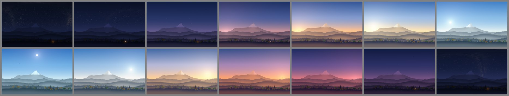
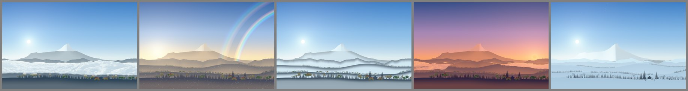
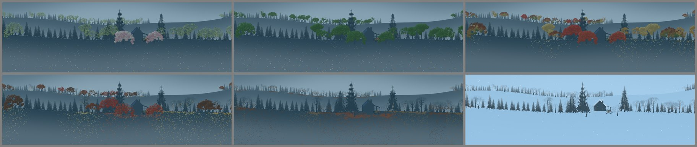
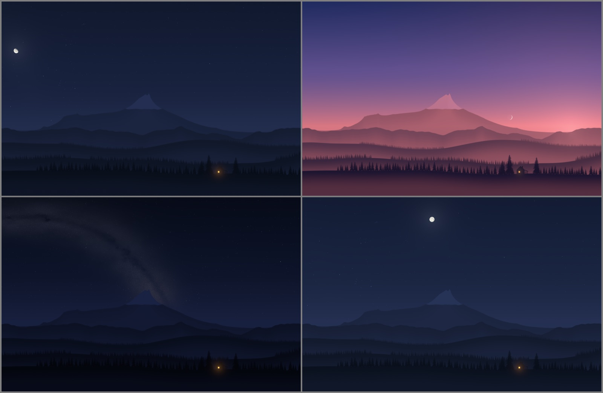
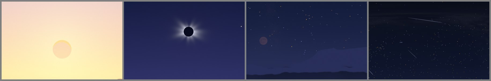
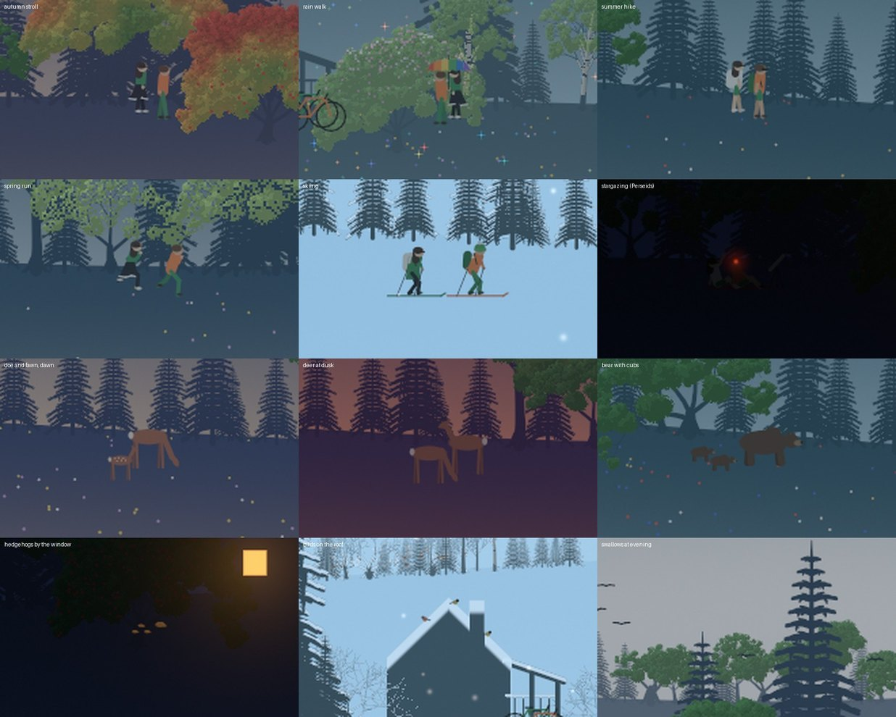

# Sky wallpaper

A dynamic wallpaper for macOS and Windows. It renders a day of a snowcapped
mountain above spruce and leafy woods and a little cabin with a porch, as
still frames, and shows the right one for the time of day. The night sky is
the real one: the moon in its phase and place, the planets, the bright
stars, the Milky Way, meteor showers and eclipses on their nights. The
year turns: blossom, green, autumn colors, fallen leaves, snow. Two people
live in the cabin and go out now and then; deer, a fox, hares, hedgehogs,
birds and, rarely, a bear with her cubs come by. Optionally, it follows
your real sunrise, sunset and hourly weather.







**Why it's cheap:** the desktop shows a still image and swaps it at set
times (17 to 19 a day, plus one per change in the weather, and one at an
eclipse's peak); nothing
animates. macOS swaps the frames itself (a
dynamic HEIC). On Windows, Task Scheduler starts a tiny helper at each
switch time; it sets the frame and exits. The installed versions render
each day once, shortly after midnight: under a minute of low-priority CPU.
On macOS, a small helper also stays loaded, but asleep: it wakes only when
you switch desktops.

No dependencies. Same inputs, same frames.

## macOS

Needs macOS 14+ and Swift (`xcode-select --install`).

```bash
git clone https://github.com/corpaci/sky-wallpaper.git
cd sky-wallpaper
```

**Daily (follows sun and weather):**

```bash
mac/install.sh --lat 48.2 --lon 16.4
```

- Without `--lat/--lon`, it uses your time zone's city.
- `--no-weather` keeps it offline; sunrise and sunset still follow the date.
- A background job (launchd) runs at 00:05, at login, and on wake if it
  missed 00:05. It renders the day for each screen, packs it and sets it.
  The log is at `~/Library/Application Support/SkyWallpaper/daily.log`.
- macOS only lets a program set the desktop (Space) that's showing, and
  full-screen apps count as desktops. So a small helper stays loaded with no
  timers: when you switch desktops, it puts today's sky on the one that comes
  into view. It uses about 30 MB of memory and no CPU while idle; its log is
  `follow.log` in the same folder.
- `mac/uninstall.sh` removes it all and puts your previous wallpaper back.

**Static (fixed times, nothing installed):**

```bash
SUNRISE=07:20 SUNSET=17:55 ./make.sh 2560x1664
```

Then go to System Settings → Wallpaper → add a photo → pick
`out/sky-2560x1664-DATE.heic` → choose the dynamic option. Use one file per
display. Its moon and stars stay those of the day you rendered it. For your pixel size: `system_profiler SPDisplaysDataType | grep Resolution`.

**Screen saver:** it's a separate setting, and by default it plays a video.
To keep the sky when idle, go to System Settings → Lock Screen → Start
Screen Saver when inactive → Never. That's also the cheapest choice.

## Windows

Needs Windows 10 or 11, nothing else: the installer compiles its helper with
the C# compiler built into Windows. No admin rights.

**Easiest:** open PowerShell (Start → type "PowerShell") and paste:

```powershell
irm https://raw.githubusercontent.com/corpaci/sky-wallpaper/main/windows/get.ps1 | iex
```

It downloads this project, asks for your town, and sets everything up in
about a minute. Press Enter at the town question to use fixed times instead.
[`get.ps1`](windows/get.ps1) is a short script you can read first.

**Or with the ZIP:** on GitHub, Code → Download ZIP. Unpack it and
double-click `windows\Install.cmd`. If Windows says it protected your PC,
choose More info → Run anyway.

**To remove it** and get your old wallpaper back, double-click
`windows\Uninstall.cmd`, or paste:

```powershell
powershell -ExecutionPolicy Bypass -File "$env:LOCALAPPDATA\SkyWallpaper\uninstall.ps1"
```

Run the installer again to change town or settings. To skip the questions,
pass them yourself:

```powershell
powershell -ExecutionPolicy Bypass -File windows\install.ps1 -Latitude 48.2 -Longitude 16.4 -NoWeather
```

- Everything lives in `%LOCALAPPDATA%\SkyWallpaper`, plus one scheduled task,
  `SkyWallpaper`. The task switches frames, renders the new day at 00:05,
  and catches up at logon, unlock and wake.
- Without a location, it uses fixed `-Sunrise 07:20 -Sunset 17:55`, and
  still renders each day, for that day's moon and stars.

If the frame looks stale:

```powershell
Get-ScheduledTaskInfo SkyWallpaper | Format-List LastRunTime, LastTaskResult, NextRunTime
Get-Content "$env:LOCALAPPDATA\SkyWallpaper\sky.log" -Tail 20
```

`LastTaskResult` 0 means the last run worked.

## The night sky

Everything in the sky stands where it really is, for your place and the
hour each frame shows:
- **The moon:** its phase, its place, its lit side toward the sun, its
  maria turned as you'd see them, earthshine on a thin crescent. A bright
  moon turns the night blue and fades the faint stars. By day it's pale.
- **Mercury to Saturn**, at their real brightness.
- **2,847 stars**, every one brighter than magnitude 5.5 (the Yale Bright
  Star Catalogue), in their colors, dimmed near the horizon.
- **The Milky Way**, on dark moonless nights: its great star clouds, dark
  dust lanes and pink glowing gas where they really are, grown out of noise
  around them, so the shapes are a model, not a photograph. Also the
  zodiacal light, the faint cone of sunlit dust along the planets' path.

The view faces the equator and spans 240°: north of it, from east-northeast
on the left to west-northwest on the right, so a rising or setting moon is
mostly in view. The moon is drawn about five times its real size, the way
it looks to us, and up to two-thirds bigger still near the horizon, where it
seems bigger to us too. Without a location, the sky is drawn for 45° north
at your time zone's longitude.

## The seasons

The year runs through the landscape, from the date (south of the equator,
half a year on), or from the forecast where it says more:
- **The summit's snow** rises and falls with the year, or follows the day's
  freezing level; low in winter, it reaches the rocky range's peaks too.
- **Leafy trees** stand among the spruces: maple, birch, beech, oak, linden,
  each built its own way (an oak short and crooked under wide limbs, a birch
  slender and white-barked under a light crown of hanging twigs). In spring
  their buds break all over at once in pale green; in autumn each turns
  through its own colors from the top down, and lets its leaves go a few at
  a time, until it's bare. Oak and beech keep their low dead leaves until
  spring. Two fruit trees by the cabin blossom white and pink in April and
  bear apples in late summer.
- **The ground:** fallen leaves gather in pools under each tree and blow out
  over the meadow, then brown through winter; flowers come in spring and
  summer, fireflies on warm midsummer nights; snow and morning frost lie where
  the forecast has them, on the branches and the roof too.

Colors that come into the landscape (leaves, flowers, bark, the bikes) take
on the light and air of the hill they're on, so they belong to the scene.

## Who lives there

Two people live in the cabin: she in mostly green and black-and-white, with
shoulder-length hair and glasses, and flowing skirts in spring and autumn;
he in green and orange, a comfy green hat in winter, sunglasses in summer.
Now and then they go out:
- a stroll in the late afternoon, a run early in the morning, a hike or a
  ski tour when there's snow, with backpacks when they're far from home;
- a walk under one rainbow umbrella when it rains;
- a bike ride (the bikes are gone from the porch);
- on clear nights, and always on a meteor shower's night, stargazing on a
  blanket on the ridge, with a telescope and a red headlamp.

Wild visitors come at their own hours: deer at dawn or dusk (a spotted fawn
in early summer, a stag with antlers from August to March), a fox at dusk, a
hare (white in winter), hedgehogs under the lit window on summer nights,
birds on the snowy roof, swallows on summer evenings, geese in a V when
they migrate, a buzzard circling, and, rarely, a bear with two cubs.



Each day's plan is fixed by its date, so a day's frames tell one story. Over
a simulated four years they're out in about 3% of frames, on about 100 days
a year, and a bear shows in about 25 frames a year.

## Rare nights and days

- **Meteor showers:** on the peak nights of the Quadrantids, Lyrids, Eta
  Aquariids, Perseids, Orionids, Leonids and Geminids, streaks fan out from
  the shower's real radiant: more the higher it stands, fewer under a
  bright moon.
- **Eclipses:** a day with an eclipse seen from your place gets a frame at
  its greatest phase, its sky at that very minute. In a solar eclipse the
  moon's disk crosses the sun's, turned as it really is; the light only
  fails near totality, and at totality the sky goes to twilight, the stars
  come out and the corona shows. In a lunar eclipse the Earth's shadow
  crosses the moon and turns it copper.

## Weather and privacy

Grey weather isn't mirrored back at you, and no cloud ever covers the sky;
the scene shows what's beyond the weather:
- **Overcast:** you're above it. A sunlit sea of clouds covers the world
  below, its base at the tops of the tall spruces by the cabin, the summit
  and far ridges rising out of it, and sun, moon and stars clear overhead.
- **Fog:** fog lakes lie low in the far valleys under a clear sky.
- **Rain:** the moment after. A rainbow stands opposite the sun while it's
  low (from this view, at the far edge, with its faint second bow), in the
  rain over the far range, and the wet grass glints in every color.
- **Cloudy:** the same sea of clouds, broken: banks of cloud lie in the
  valleys, with the hills showing between them.
- **Snow:** the clear morning after: fresh snow on open ground, and ice
  glittering in the air.

The forecast also gives the temperature, the snow lying and the freezing
level, for the seasons above.

Weather comes from [Open-Meteo](https://open-meteo.com): free, no account,
no key. Once a day, one request carries the date and your coordinates
rounded to 0.1° (about 10 km). On Windows, the town you type at install is
looked up once on Open-Meteo too. Nothing else leaves the machine. The response
is kept beside the frames as `forecast.json`. Each frame takes its hour's
sky, and an extra frame goes on every hour where the sky changes. If the
forecast can't be fetched, the day renders without weather.

## Options

| What | macOS daily | macOS static | Windows | Default |
|---|---|---|---|---|
| Location | `--lat`, `--lon` | — | `-Latitude`, `-Longitude` | macOS: time zone's city; Windows: asks for your town |
| Weather off | `--no-weather` | always off | `-NoWeather` | on, when located |
| Fixed sunrise, sunset | — | `SUNRISE`, `SUNSET` | `-Sunrise`, `-Sunset` | `07:20`, `17:55` |
| Landscape (another seed, other mountains) | `--seed` | `SEED` | `-Seed` | `7` |

The renderers also run by hand. For example, this prints a day's schedule
without rendering:

```bash
.build/release/wallframes --dry-run --lat 48.2 --lon 16.4 --date 2026-12-21 --weather
```

`--sky rain` forces one weather type for every frame. `--forecast FILE`
reads a saved forecast.

## Your own images (macOS)

Any same-size stills work. Write a manifest of local switch times:

```
# HH:MM  path        [primary] [light] [dark]
06:30  dawn.jpg
12:00  noon.jpg      light
18:45  dusk.jpg      primary
22:00  night.jpg     dark
```

```bash
.build/release/heicpack manifest.txt -o mine.heic
.build/release/heicpack --inspect mine.heic   # print any wallpaper's schedule
```

## Changing the look

The renderer exists twice, kept in step file by file: Swift
(`Sources/wallframes/`) and C# (`windows/src/`). After changing either one,
run these on a Mac with Mono (`brew install mono`):

```bash
windows/parity.sh     # every sky, a real forecast day and rare days, pixel by pixel
tests/daylight.sh     # sunrise and sunset against published times
tests/astronomy.sh    # eclipses, conjunctions and the like against known dates
```

`data/bsc5-vmag5.5.tsv` is the star catalogue as downloaded; after changing
it, `swift tools/stars.swift` rewrites the stars for both renderers.

## Status

- **macOS:** the daily job and the desktop helper are installed and work on
  the author's Mac, and the wallpaper stays dynamic. Still open: whether
  macOS ever trims its own copies of past days' wallpapers, and the first
  00:05 run.
- **Windows:** the earlier version runs on a real PC. These haven't run on
  Windows yet:
  - the daily `tick` (rendering, re-registering the task, weather), though
    it compiles and its task XML validates;
  - the one-line and double-click installers.

Details and measurements: [docs/NOTES.md](docs/NOTES.md).

## Credits

Stars: the Bright Star Catalogue, 5th revised edition (Hoffleit and Warren,
1991; catalogue V/50), retrieved with the VizieR catalogue access tool, CDS,
Strasbourg, France ([doi:10.26093/cds/vizier](https://doi.org/10.26093/cds/vizier)).
Positions of the sun, moon and planets follow Paul Schlyter's
[How to compute planetary positions](https://stjarnhimlen.se/comp/ppcomp.html).
